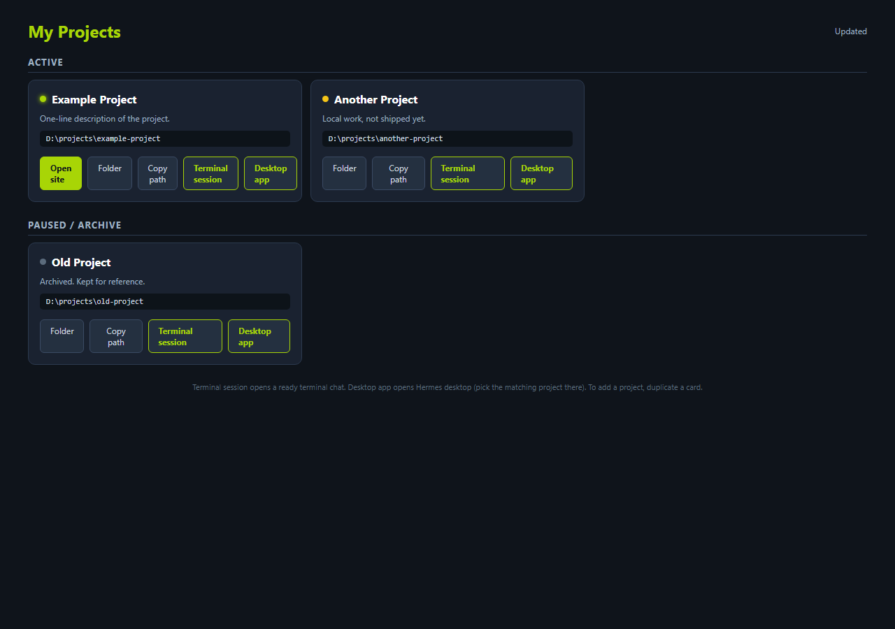

<div align="center">

# Hermes Projects Hub

### One picker page for all your projects. Each card opens a ready Hermes session.

**Pick a project. Land in a chat that already knows it.**

[](LICENSE)
[](#quick-start)
[](SKILL.md)
[](picker.html)

[Quick start](#quick-start) · [How it works](#how-it-works) · [FAQ](#faq) · [Documentation](#documentation)

</div>

> [!IMPORTANT]
> Get this project only from
> [engmhmdnsr/hermes-projects-hub](https://github.com/engmhmdnsr/hermes-projects-hub).
> A similar repository name or copied README does not establish that a
> download is official.

Pick a card, land in a session that already has the project context
(`AGENTS.md` auto-loads from the session folder). No copy-paste of paths,
no explaining the project twice.

## Quick start

### 1. Copy the picker page

Copy `picker.html` anywhere (for example a `projects` folder) and add one
card per project. Each card carries its local path in a `code` element:

```html
<div class="card">
<h3><span class="dot live"></span>My Project</h3>
<p class="desc">One-line description.</p>
<code>D:\projects\my-project</code>
<div class="btns">
<a href="file:///D:/projects/my-project/">Folder</a>
</div>
</div>
```

Session buttons are generated, not hand-written: one script reads each
card's path and appends the buttons, so adding a project is card-only.

### 2. Register the protocol (once)

```powershell
.\windows\register-protocol.ps1
```

This registers your own URL scheme (default `mysessions://`) pointing at
the windowless `windows/session-launcher.vbs`. Click a card's
**Terminal session** button and allow the protocol once.

### 3. Give each project its context

Put an `AGENTS.md` (copy `templates/AGENTS.md`) in every project folder:
what it is, key files, deploy notes, standing rules. Any session started
in that folder loads it automatically, which is what makes a new session
"ready".

### 4. Mirror the folders in Hermes Desktop

Create one desktop Project per folder. The card's **Desktop app** button
(`hermes://open/sessions`) focuses Hermes Desktop, where you pick the
matching Project and start a context-loaded chat.

## How it works

The page script reads each card's path and appends two buttons:

| Button | Target | What happens |
| ------ | ------ | ------------ |
| Terminal session | `mysessions://D:/projects/x` | Windowless VBS sets the folder and runs `hermes chat` there |
| Desktop app | `hermes://open/sessions` | Focuses Hermes Desktop on the sessions view |

There is no deep link that creates a desktop session with a given cwd
(verified against the desktop build: supported kinds are
`open/<in-app-route>` and `<plugin-id>/<page>` only), so the two-button
split is the mechanism. Never register `hermes://` yourself: it is owned
by Hermes Desktop and hijacking it breaks the app's own deep links.



## FAQ

<details>
<summary><strong>Clicking Terminal session flashes a black window. Why?</strong></summary>

You are running a `.bat` or console command as the handler. Use the
provided `.vbs` through `wscript.exe`: it is windowless by design.

</details>

<details>
<summary><strong>The button does nothing / shows a protocol error.</strong></summary>

The scheme is not registered. Re-run `windows/register-protocol.ps1`,
then click again and accept the browser's "allow this protocol" prompt.
Check `session-launcher.log` next to the VBS: every invocation is logged
with the raw URL, the resolved folder, and whether it exists.

</details>

<details>
<summary><strong>It says "Folder not found".</strong></summary>

The card's path does not exist on this machine. The message box shows the
received URL: compare it with the card's `code` element and fix the path.

</details>

<details>
<summary><strong>Can one click open a desktop session in the right project?</strong></summary>

No. The desktop build has no route that creates a session with a given
cwd. The card opens Desktop on the sessions view; one more click picks
the Project. Desktop Projects are what carry the context there.

</details>

<details>
<summary><strong>How do I add a project later?</strong></summary>

Ask first (standing rule, see `templates/00-RULES.md`), then: append the
card, write the project's `AGENTS.md`, create the desktop Project, and
verify every card path exists on disk.

</details>

## Documentation

- [SKILL.md](SKILL.md): the agent skill. Give it to your agent and say
  "set up my projects hub" or "add project X to my hub".
- [picker.html](picker.html): the picker page template.
- [templates/AGENTS.md](templates/AGENTS.md): per-project context template.
- [templates/00-RULES.md](templates/00-RULES.md): standing-rule template.
- [windows/](windows/): `session-launcher.vbs` + `register-protocol.ps1`.

## Contributing

Open an issue to report a bug or suggest a feature, or send a pull request
to improve the page, the handler, or the docs.

## License

[MIT](LICENSE)
